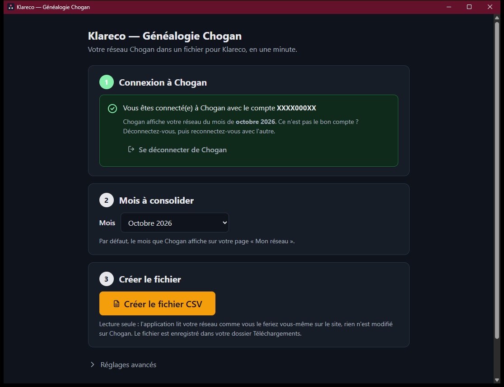

# Généalogie Chogan

**Votre réseau Chogan dans un fichier pour Klareco, en une minute.**

Généalogie Chogan est une petite application pour Windows et Mac. Elle lit votre réseau sur le
site Chogan, exactement comme vous le feriez vous-même page après page, et en fait un fichier
CSV prêt à déposer dans Klareco (rubrique *Imports Chogan*). Là où l'ancienne extension Chrome
prenait quinze à trente minutes, l'application prend environ une minute.

- **Lecture seule** : rien n'est modifié sur Chogan.
- **Aucun identifiant enregistré** : vous vous connectez sur la page Chogan elle-même, dans
  l'application.
- **Rien ne quitte votre ordinateur**, sauf le fichier que vous déposez vous-même dans Klareco.

## Télécharger

Toutes les versions sont sur la page **[Releases](../../releases/latest)**. Prenez le fichier
qui correspond à votre ordinateur :

| Ordinateur | Fichier à télécharger |
|---|---|
| Windows 10 ou 11 | `Genealogie-Chogan-…-windows-setup.exe` (installeur) ou `…-windows-portable.exe` (sans installation, à lancer directement) |
| Mac (Intel ou Apple Silicon) | `Genealogie-Chogan-…-macos.dmg` |

## Installer sur Windows

1. Ouvrez le fichier téléchargé.
2. Windows affiche **« Windows a protégé votre ordinateur »** : c'est normal, l'application n'est
   pas encore signée auprès de Microsoft. Cliquez sur **Informations complémentaires**, puis sur
   **Exécuter quand même**. Cet écran n'apparaît qu'une fois.
3. Avec l'installeur, suivez les étapes ; l'application apparaît ensuite dans le menu Démarrer sous
   le nom *Genealogie Chogan*. Avec la version portable, il n'y a rien à installer : le fichier
   s'ouvre directement.

L'application a besoin du composant Microsoft *WebView2*, déjà présent sur Windows 11 et sur la
plupart des Windows 10 ; s'il manque, l'installeur le télécharge.

## Installer sur Mac

1. Ouvrez le fichier `.dmg` et glissez *Genealogie Chogan* dans le dossier *Applications*.
2. Au premier lancement, macOS refuse d'ouvrir une application qui n'est pas signée par un
   développeur identifié. Deux façons de passer :
   - **clic droit** (ou Ctrl + clic) sur l'application → **Ouvrir** → **Ouvrir** ;
   - ou, après un premier refus, *Réglages Système* → *Confidentialité et sécurité* → bouton
     **Ouvrir quand même** en bas de la page.
3. Les fois suivantes, l'application s'ouvre normalement.

## Utiliser l'application

1. **Connexion à Chogan.** Au premier lancement, la page de connexion Chogan s'ouvre dans la
   fenêtre. Connectez-vous comme d'habitude ; l'application revient d'elle-même au panneau et
   affiche *Vous êtes connecté(e) avec le compte …*. La connexion est ensuite mémorisée par la
   fenêtre, comme dans un navigateur. *Se déconnecter de Chogan* permet de changer de compte.
2. **Mois à consolider.** Le mois affiché par Chogan sur votre page « Mon réseau » est
   présélectionné ; vous pouvez en choisir un autre dans la liste.
3. **Créer le fichier CSV.** Une barre de progression indique ce que l'application lit. À la fin,
   *Votre fichier est prêt* : le fichier est dans votre dossier **Téléchargements**, le bouton
   **Ouvrir le dossier** l'affiche. Déposez-le ensuite dans Klareco, rubrique *Imports Chogan*,
   comme avec l'ancienne extension.

Un encadré vert confirme que les chiffres lus correspondent aux compteurs de Chogan. S'il est
orange, le fichier est utilisable mais quelques écarts méritent un coup d'œil ; ils sont listés.

## Questions fréquentes

**L'application dit que je ne suis pas connecté(e) alors que je le suis dans mon navigateur.**
C'est normal : l'application a sa propre session, indépendante de Chrome ou Safari. Connectez-vous
une fois dans l'application.

**Chogan ne répond pas.** Vérifiez votre connexion internet, puis cliquez sur *Réessayer*. Si
Chogan est en panne, réessayez plus tard.

**Chogan limite le nombre de requêtes.** Attendez une minute, ouvrez *Réglages avancés* et baissez
la *Vitesse* (par exemple 2), puis relancez.

**Où est le fichier ?** Dans votre dossier Téléchargements, sous un nom comme
`genealogie_CODE_2026-10-21.csv`. Le bouton *Ouvrir le dossier* l'affiche directement.

**Est-ce que l'application envoie mes données quelque part ?** Non. Elle lit le site Chogan avec
votre session et écrit un fichier sur votre disque. Aucun serveur, aucun identifiant enregistré.

## Besoin d'aide ?

Ouvrez une [issue](../../issues) en décrivant ce que vous voyez à l'écran. En cas d'erreur,
l'application propose un lien *Détails techniques* : copiez son contenu dans l'issue, il ne
contient aucune donnée personnelle ni aucun mot de passe.

---

Application développée par 3juillet pour les consultantes Chogan utilisant Klareco. Les binaires
publiés ici sont fournis tels quels ; le code source n'est pas public.
